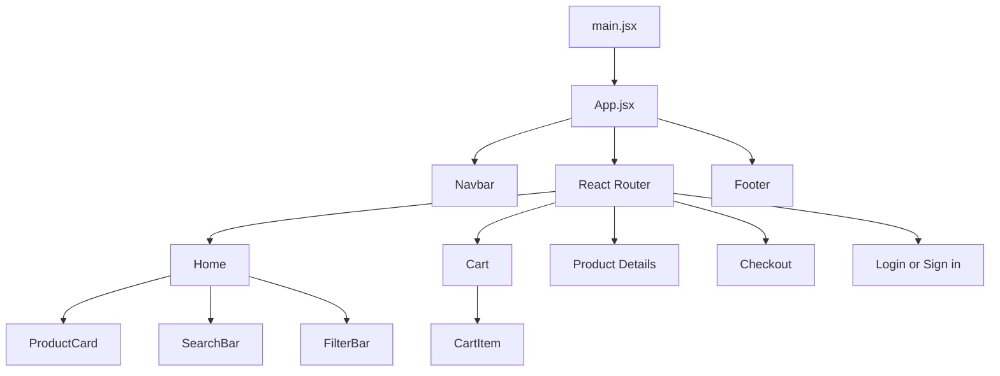
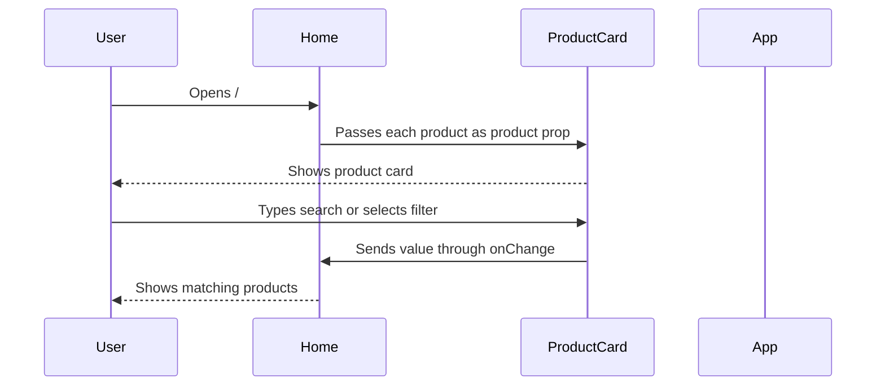
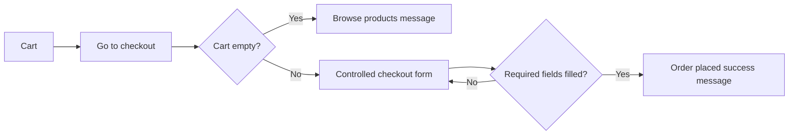

# ShopNest JSX Workflow Guide

This guide explains every JSX file in ShopNest and how the website works from start to finish.

## 1. Overall Flow



`main.jsx` starts React. `App.jsx` supplies the shared layout, routes, cart state, and theme state. The router chooses one page based on the URL.

## 2. All JSX Files

There are 13 JSX files:

```text
src/
├── main.jsx
├── App.jsx
├── components/
│   ├── Navbar.jsx
│   ├── ProductCard.jsx
│   ├── SearchBar.jsx
│   ├── FilterBar.jsx
│   ├── CartItem.jsx
│   └── Footer.jsx
└── pages/
    ├── Home.jsx
    ├── Cart.jsx
    ├── ProductDetails.jsx
    ├── Checkout.jsx
    └── Auth.jsx
```

## 3. Entry File

### `src/main.jsx`

**Purpose:** Starts the React application.

**Workflow:**

1. Imports React's `StrictMode`.
2. Finds the HTML element with `id="root"`.
3. Renders the `App` component inside that element.
4. Imports `index.css` for global CSS.

```jsx
createRoot(document.getElementById('root')).render(
  <StrictMode><App /></StrictMode>
)
```

`main.jsx` does not contain product or cart logic. It only starts the application.

## 4. Main Application File

### `src/App.jsx`

**Purpose:** The main parent component. It owns shared state and connects all pages.

**State used:**

- `cart`: products currently in the shopping cart
- `darkMode`: selected light or dark theme

**Important responsibilities:**

- Loads the saved cart from localStorage when the app starts.
- Saves cart changes to localStorage with `useEffect`.
- Saves the selected theme with another `useEffect`.
- Adds products to the cart.
- Increases, decreases, and removes quantities.
- Calculates the cart item count for the navbar.
- Defines all React Router routes.

**Props passed down:**

```jsx
<Navbar cartCount={cartCount} ... />
<Home products={products} onAddToCart={addToCart} />
<Cart cart={cart} onIncrease={increaseQuantity} ... />
<ProductDetails products={products} onAddToCart={addToCart} />
<Checkout cart={cart} />
```

This is the parent-to-child flow: `App` owns the important data, then passes data and functions to child components through props.

## 5. Reusable Components

### `src/components/Navbar.jsx`

**Purpose:** Displays the logo, navigation links, cart count, and theme button.

**Props:**

- `cartCount`: number shown beside Cart
- `darkMode`: tells the button whether the current theme is dark
- `onToggleTheme`: function called when the theme button is clicked

**Workflow:**

1. User clicks Home, Cart, or Login.
2. `NavLink` changes the URL without a full browser refresh.
3. `cartCount` updates automatically when the cart state changes in `App`.

### `src/components/ProductCard.jsx`

**Purpose:** Displays one product in the catalog.

**Props:**

```jsx
<ProductCard product={product} onAddToCart={onAddToCart} />
```

**Workflow:**

1. Receives one product object from `Home`.
2. Displays the product image, name, category, price, rating, and stock.
3. The details link goes to `/product/:id`.
4. The Add to cart button calls the handler received from `App`.
5. The button is disabled when stock is zero.

### `src/components/SearchBar.jsx`

**Purpose:** Provides the catalog search input.

**Props:**

- `searchTerm`: current input value
- `onSearchChange`: function that updates the search value

This is a controlled input. Its value comes from React state, and `onChange` sends the new text to `Home`.

### `src/components/FilterBar.jsx`

**Purpose:** Provides category buttons and the sorting dropdown.

**Props:**

- `category`
- `onCategoryChange`
- `sortOption`
- `onSortChange`

The category buttons use `.map()` and `key={item}`. The selected category and sort option are controlled by state in `Home`.

### `src/components/CartItem.jsx`

**Purpose:** Displays one product already added to the cart.

**Props:**

- `item`
- `onIncrease`
- `onDecrease`
- `onRemove`

The buttons do not own the cart state. They call functions passed down from `App`, which updates the shared cart.

### `src/components/Footer.jsx`

**Purpose:** Displays the ShopNest logo, footer links, and copyright text.

It is rendered by `App`, so it appears on every route.

## 6. Page Files

### `src/pages/Home.jsx`

**Purpose:** Catalog home page at `/`.

**State used:**

- `searchTerm`
- `category`
- `sortOption`

**Workflow:**

1. Receives all products from `App`.
2. Filters products by search text and category.
3. Sorts the matching products when a sort option is selected.
4. Uses `.map()` to render one `ProductCard` per product.
5. Shows `No products found` when the filtered array is empty.

```jsx
visibleProducts.map((product) => (
  <ProductCard key={product.id} product={product} />
))
```

The `key` is important because React needs a unique identity for each mapped product.

### `src/pages/Cart.jsx`

**Purpose:** Shopping cart page at `/cart`.

**Workflow:**

1. Receives the cart and quantity functions from `App`.
2. Uses `reduce()` to calculate item count, subtotal, shipping, and total.
3. Uses `.map()` to render one `CartItem` for each cart item.
4. Shows an empty-cart message when `cart.length === 0`.
5. Provides a link to checkout when the cart contains products.

### `src/pages/ProductDetails.jsx`

**Purpose:** Product details page at `/product/:id`.

**Workflow:**

1. `useParams()` reads the `id` from the URL.
2. `Number(id)` converts the URL string to a number.
3. `.find()` searches for the matching product.
4. If no product is found, it displays `Product not found.`
5. If a product is found, it displays details and an Add to cart button.

Example URLs:

- `/product/1`
- `/product/15`
- `/product/999` shows the invalid-product state

### `src/pages/Checkout.jsx`

**Purpose:** Demo checkout page at `/checkout`.

**State used:**

- `form`: name, email, and address values
- `submitted`: controls the success message

**Workflow:**

1. Receives the cart from `App`.
2. Shows an empty state if there is no cart.
3. Displays the order summary with `.map()`.
4. Controlled inputs update `form` through `handleChange`.
5. `handleSubmit` calls `preventDefault()` so the browser does not reload.
6. Required values are checked.
7. `submitted` becomes `true` and the success message is rendered.

No payment information is requested and no real order is processed.

### `src/pages/Auth.jsx`

**Purpose:** Provides both authentication demo pages.

**Routes:**

- `/login`: sign-in form
- `/signin`: create-account form

**Workflow:**

1. `useLocation()` checks the current route.
2. The page displays either sign-in or create-account wording.
3. Controlled inputs update local form state.
4. Submit shows a success message.
5. No real account or password is stored because this project has no backend.

## 7. Main Website Workflows

### Browse Products



### Add a Product to Cart

1. User clicks Add to cart on a `ProductCard`.
2. `ProductCard` calls `onAddToCart(product)`.
3. `App.jsx` checks whether the product already exists.
4. If it exists, quantity increases.
5. If it does not exist, a new item with `quantity: 1` is added.
6. React re-renders the navbar count and cart page.
7. The cart `useEffect` saves the new array to localStorage.

### Change Cart Quantity

1. `Cart` maps each product to a `CartItem`.
2. `CartItem` calls `onIncrease(item.id)` or `onDecrease(item.id)`.
3. `App` creates a new cart array using `.map()`.
4. Decreasing the quantity to zero removes the item with `.filter()`.
5. New totals are calculated by `reduce()`.

### Checkout



### Login or Sign In

1. User clicks Login in the navbar.
2. React Router opens `/login`.
3. `Auth.jsx` renders the sign-in form.
4. The user can open `/signin` to create an account.
5. The form is controlled with `useState`.
6. Submission shows a demo success message only.

### Theme Persistence

1. `App` loads the saved theme from localStorage.
2. The theme button changes `darkMode` with `useState`.
3. The theme `useEffect` adds or removes the `dark-mode` class on `body`.
4. The selected theme is saved for the next refresh.

## 8. Where React Concepts Appear

| Concept | File and example |
| --- | --- |
| Components | All files define focused functional components |
| Props | `ProductCard product={product}` in `Home.jsx` |
| `useState` | Search/filter state in `Home`, cart state in `App`, form state in `Checkout` |
| `useEffect` | localStorage persistence in `App.jsx` |
| `.map()` | Products in `Home`, cart items in `Cart`, fields/options in components |
| `key` | `key={product.id}`, `key={item.id}`, and `key={item}` |
| Controlled input | `value={searchTerm}` and checkout `value={form.name}` |
| `onChange` | SearchBar, FilterBar, Checkout, and Auth |
| `onSubmit` | Checkout and Auth forms |
| Conditional rendering | Empty cart, no results, stock, invalid ID, and success states |
| React Router | Routes in `App.jsx`, `Link`, `NavLink`, and `useParams` |
| localStorage | Cart and theme persistence in `App.jsx` |
| Responsive CSS | Media queries in `App.css` |

## 9. Easy Viva Explanation

The simplest explanation is:

> `App.jsx` is the parent. It owns the cart and passes cart data and functions to the pages. `Home.jsx` owns catalog controls like search and filters. Reusable components display individual pieces. React state updates the screen, `useEffect` saves data to localStorage, and React Router changes the page view without reloading the browser.

## 10. Running the Website

```bash
npm install
npm run dev
```

Open the local URL printed by Vite, usually `http://localhost:5173/`.
